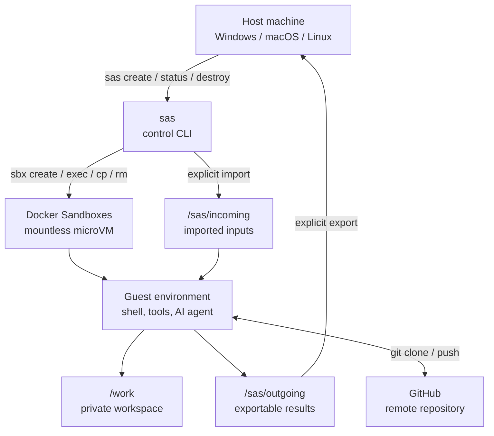
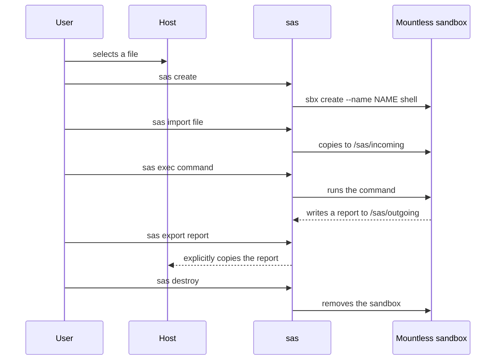

# Secure Agent Sandbox

> A disposable cyber execution environment for analyzing files, running
> commands, and hosting AI agents without mounting the host workspace into the
> sandbox.

## 1. Overview

Secure Agent Sandbox (`sas`) is a small control layer built on top of
[Docker Sandboxes](https://docs.docker.com/ai/sandboxes/). This project does
not reimplement low-level isolation: Docker provides the microVM, guest
operating system, and separation mechanisms. `sas` provides security-oriented
orchestration and a focused operator experience.

### Product objective

Allow a user or AI agent to:

- test an unknown file or archive;
- run a potentially destructive command;
- install dependencies and analysis tools;
- clone and modify a Git repository inside an isolated environment;
- produce a report or push a change to GitHub;
- destroy the environment without directly modifying the host machine.

### Guiding principle

```text
The host machine must never be an implicit workspace.

Input:      explicit transfer into the sandbox
Processing: execution inside the microVM
Output:     explicit export or remote Git repository
```

## 2. Target architecture



### Trust boundaries

| Zone | Responsibility | Trust level |
| --- | --- | --- |
| Host machine | Control, input selection, output reception | High |
| `sas` CLI | Orchestration and transfer filtering | Project code |
| Docker Sandboxes | MicroVM, guest filesystem and guest daemon isolation | Infrastructure |
| Agent or command | Execution of tested code | Untrusted |
| GitHub | Optional remote repository and exchange point | External |

Code executed inside the sandbox is assumed to be able to delete, modify, or
compromise everything inside the sandbox. The security objective is to prevent
that activity from crossing into the host, except through channels explicitly
enabled by the user.

## 3. Operational flows

### 3.1 File analysis session



### 3.2 Git-based development session

The host repository is not mounted. The working repository is cloned inside
the microVM, and GitHub acts as an optional exchange point:

```text
GitHub
  ▲  git push
  │
Sandbox: /work/repository
  │  git clone
  ▼
GitHub

The checkout on the host remains outside the sandbox.
```

Typical workflow:

```powershell
sas create
sas shell
```

Then, inside the sandbox:

```bash
mkdir -p /work
git clone https://github.com/OWNER/REPOSITORY.git /work/repository
cd /work/repository
# develop, test, and commit
git push origin main
```

## 4. CLI behavior

| Command | Purpose | Effect on the host |
| --- | --- | --- |
| `sas create` | Create a mountless sandbox | Writes only `.sas/sandbox.json` |
| `sas status` | List Docker Sandboxes | Read-only |
| `sas shell` | Open a guest shell | No host workspace |
| `sas exec ...` | Run a guest command | No implicit host access |
| `sas import FILE` | Copy a selected file | Reads only `FILE` |
| `sas export GUEST HOST` | Copy a selected output | Writes only `HOST` |
| `sas destroy` | Remove the sandbox and state | Removes local session state |

### Implementation rules

The CLI:

1. calls `sbx`, not `docker run` or `docker exec`;
2. never passes the current directory to `sbx create`;
3. uses `/sas/incoming` for imported inputs;
4. rejects exports that are not below `/sas/outgoing`;
5. stores only the functional session identifier in `.sas/`;
6. does not automatically pass any secret.

## 5. Security model

### Intended guarantees

- no automatic host workspace mount;
- filesystem private to the microVM;
- separate guest Docker daemon;
- network controlled by Docker Sandboxes;
- explicit file imports and exports;
- destruction of the working environment with `sas destroy`.

### What this project does not automatically guarantee

Security can be weakened if the user explicitly enables:

- a shared workspace;
- host credentials;
- a local MCP server;
- writable shared skills;
- published ports;
- a permissive network policy;
- a host device or integration.

For potentially malicious files, the recommended operating profile is:

```text
workspace        = mountless
network          = Locked Down / deny by default
local MCP        = disabled
host credentials = disabled
published ports  = disabled
export           = manual and reviewed
```

Docker Sandboxes remains the primary security boundary. `sas` must not be
presented as an absolute-isolation guarantee or as a complete high-assurance
malware-analysis platform.

## 6. Project status

### Available in the prototype

- [x] mountless creation through `sbx`;
- [x] shell and command execution;
- [x] explicit single-file import;
- [x] export restricted to `/sas/outgoing`;
- [x] minimal local session tracking;
- [x] wrapper unit tests;
- [x] baseline security documentation.

### To be implemented

- [ ] actual validation of `sandbox/spec.yaml`;
- [ ] `sbx` version checks at startup;
- [ ] effective command and session timeouts;
- [ ] effective export-size limits;
- [ ] controlled archive and directory import;
- [ ] `offline`, `analysis`, and `lab-network` profiles;
- [ ] Docker Sandbox integration tests;
- [ ] documented AI-agent support;
- [ ] secret-safe session logging;
- [ ] open-source license.

> Important: [sandbox/spec.yaml](sandbox/spec.yaml) currently describes the
> target policy. The CLI does not yet enforce every field in that file.

## 7. Repository structure

```text
.
├── sandbox/
│   ├── cli.py       # sas -> sbx orchestration
│   ├── spec.yaml    # target policy and parameters
│   └── __init__.py
├── tests/
│   └── test_cli.py  # Docker-free unit tests
├── pyproject.toml   # packaging and sas entry point
├── sas.py           # direct Python launcher
├── Dockerfile       # legacy artifact, not the security boundary
└── README.md        # architecture and operating guide
```

## 8. Installation and prerequisites

- Docker Desktop with Docker Sandboxes enabled;
- `sbx` CLI version `0.42.0` or newer;
- Python 3.14 or newer;
- Git if a repository is cloned inside the sandbox.

Verify the local tools:

```powershell
docker version
sbx --version
python --version
```

Install the local CLI:

```powershell
python -m pip install -e .
```

Docker documentation:

- [Docker Sandboxes](https://docs.docker.com/ai/sandboxes/)
- [Architecture](https://docs.docker.com/ai/sandboxes/architecture/)
- [Security model](https://docs.docker.com/ai/sandboxes/security/)

## 9. Operating procedure

### Create and inspect a session

```powershell
sas create
sas status
sas shell
```

### Import and analyze a file

```powershell
sas import .\sample.zip
sas exec bash -lc "file /sas/incoming/sample.zip"
sas exec bash -lc "mkdir -p /sas/outgoing && file /sas/incoming/sample.zip > /sas/outgoing/report.txt"
```

### Export a result

```powershell
New-Item -ItemType Directory -Force .\reports
sas export /sas/outgoing/report.txt .\reports
```

### End a session

```powershell
sas destroy
```

Do not export an archive or file without reviewing it first. A result produced
by untrusted software may itself contain executable code or sensitive data.

## 10. Testing and validation

Unit tests do not require Docker:

```powershell
python -m unittest discover -s tests -v
```

Manual integration testing requires Docker Sandboxes:

```powershell
sas create --name sas-integration
sas exec sh -lc "printf 'ok' > /sas/outgoing/health.txt"
sas export /sas/outgoing/health.txt .\reports
sas destroy
```

Acceptance criteria for the next version:

1. no host path is passed during creation;
2. a host file is visible only after `sas import`;
3. a file is written to the host only after `sas export`;
4. exports outside `/sas/outgoing` are rejected;
5. destroying a session removes the guest environment;
6. locked-down networking is verifiable and documented;
7. integration tests cover host/sandbox boundaries.

## 11. Delivery roadmap

### P0 — Stabilize the security boundary

- validate the presence and version of `sbx`;
- remove options that could enable implicit workspace mounts;
- add `sas validate`;
- formalize session states and error handling;
- add baseline integration tests.

### P1 — Make limits effective

- command and session timeouts;
- import/export size limits;
- archive type and size checks;
- safe cleanup of orphaned state;
- explicit network profiles.

### P2 — Support cyber use cases

- reproducible analysis kits;
- offline and lab profiles;
- structured reports;
- AI-agent support and policy;
- logging without secrets.

### P3 — Industrialize

- CI with unit and integration tests;
- image scanning and SBOM generation;
- versioning and release process;
- threat-model documentation;
- open-source license and contribution guidelines.

## 12. Architecture decisions

| Decision | Choice | Rationale |
| --- | --- | --- |
| Isolation boundary | Docker Sandboxes | Managed microVM instead of a classic container |
| Default workspace | No mount | Prevents silent host modifications |
| File exchange | Explicit import/export | Reduces unintended data channels |
| Code exchange | Remote GitHub repository | Separates the host checkout from the working checkout |
| Analysis network | Locked Down | Reduces downloads, exfiltration, and command-and-control traffic |
| Secrets | No automatic inheritance | Prevents exposing tokens to the agent |
| Dockerfile role | Secondary | Not the security boundary |

## License

No license has been selected yet. Until a license is added, public visibility
does not automatically grant permission to reuse, modify, or redistribute the
code.
